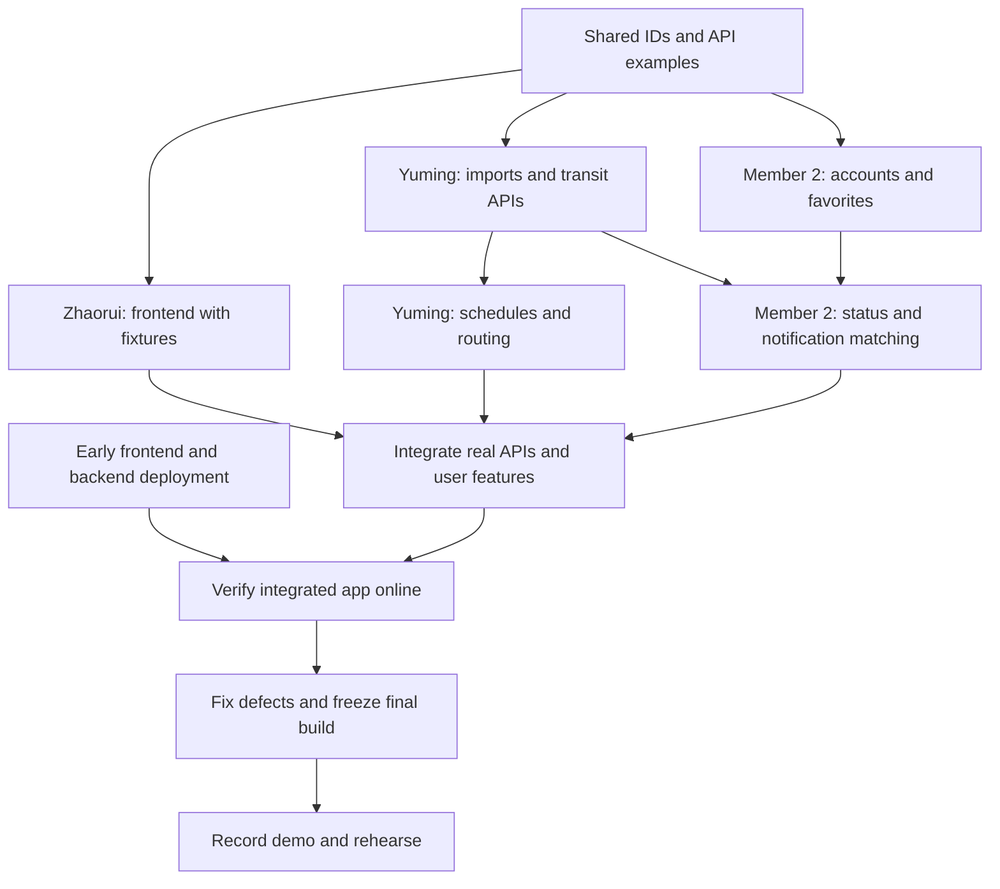

# NYC Transit Hub — Three-Member Final Delivery Workplan

Updated: November 24, 2026  
Final presentation: November 30, 2026  
Delivery: deployed web application

This plan replaces the previous four-member checkpoint plan. It describes remaining delivery work and the final feature target; it does not certify that old tasks are complete. During S1, verify the current implementation and skip tasks already satisfied by evidence.

## 1. Team ownership

| Member | Primary ownership | Responsibilities |
| --- | --- | --- |
| **Member 1 — Yuming Lin** | Transit data, routing, technical integration | Static imports; shared identifiers and API contracts; subway/bus feed integration; schedules; routing; integration reviews and deployed transit verification |
| **Member 2 — name to confirm** | Accounts, personalized features, supporting APIs, backend deployment | Firebase; favorites; subscriptions; in-app notifications; service-status and equipment APIs; hosted Flask backend |
| **Member 3 — Zhaorui** | Frontend, visualization, frontend deployment | Existing frontend integration; map; search and transit details; dashboard; journey planner; account and notification UI; languages; responsive layout; hosted frontend |
| **All three** | Quality and final presentation | Test owned features, resolve integration defects, document behavior, prepare evidence, and rehearse |

Yuming coordinates integration; each owner implements and verifies their own work. Member 2 owns equipment retrieval and status/equipment endpoints, with Yuming supplying shared mappings and helping interpret transit data. Zhaorui owns shared frontend request/refresh code; coordinate changes with Yuming instead of editing it independently.

## 2. Agreed final scope

| Feature | Final target |
| --- | --- |
| Coverage | NYC subway and buses. State actual agency/route coverage explicitly; do not claim commuter-rail or every MTA service without implementation. |
| Search and transit details | Search/select subway stations and bus stops/routes; show routes, directions, and relevant information. |
| Live updates | Official arrival predictions and available bus positions, source timestamps, automatic/manual refresh, and explicit failure/stale states. |
| Schedules | Date-appropriate scheduled departures, clearly distinguished from live predictions. |
| Interactive map | Actual route geometry and selectable stations/stops, connected to details; supported live overlays. |
| Service alerts/status | Relevant alerts and overview of supported services, with source-supported statuses and unknown/unavailable states. |
| Journey planning | Origin/destination selection; valid directional connections and transfers; understandable journey legs. Define supported modes and timing limitations. |
| Accounts | Required Firebase authentication, sign-in/out, session restoration, and deployed-domain configuration. Existing Google sign-in can create the Firebase user on first successful sign-in. |
| Favorites | Persistent subway stations, bus stops, and routes, separated by user. |
| In-app notifications | Enable/disable subscriptions; match relevant disruptions; unread indicator and read state; avoid duplicates. Refresh while the app is in use. Background browser push/email is outside this delivery scope. |
| Equipment information | Station-associated elevator/escalator information and reported outages where supported; distinguish unknown from confirmed availability. |
| Languages | User-selectable interface language with remembered choice. Initial dictionaries: English and Simplified Chinese; confirm any other languages before adding them. Original MTA text remains identified as such unless translated. |
| Delivery | Public HTTPS deployment, responsive and keyboard-usable interface, current documentation, verified user flows, slides and recorded backup demo. |

Routing, schedules, map geometry, and status coverage must be backed by the implemented data. Do not use placeholders or a simulated feed as evidence of a completed live feature.

## 3. Tracking and definition of done

Task states: **Not started → In progress → Ready for integration → Verified on deployment**.

For import/library tasks, first verify reproducible outputs and tests; verify their dependent application behavior on deployment before closing the feature. Record evidence such as a commit/PR, test result, response example, or deployed workflow result. “Code exists” is not the same as “finished.”

Each task below is a checklist item. S1 establishes its actual current state. Dates are targets, not evidence of completion.

## 4. Shared setup — first priority

| ID | Small task | Primary owner | Depends on | Completion check |
| --- | --- | --- | --- | --- |
| S1 | Review main, the frontend branch, newer changes, available credentials, and existing deployment. Mark every feature complete/partial/missing with evidence. | Yuming coordinates; all | None | Current status and blockers are recorded; existing work is reused. |
| S2 | Confirm the three owners, Member 2's name, availability, and task handoffs. | All | S1 | Every remaining task has a primary owner. |
| S3 | Agree on namespaces for subway parent/platform IDs, bus stop IDs, routes, agencies, and transit modes. | Yuming | S1 | Examples prevent cross-mode ID collisions and mapping ambiguity. |
| S4 | Document requests, fields, sources/timestamps, and success/empty/error examples for each new API; preserve existing callers. | Yuming leads; all review | S3 | Backend and frontend can implement the same contracts independently. |
| S5 | Verify the existing frontend branch with live Flask, fix blockers, and integrate through a reviewed change. | Zhaorui; Yuming reviews | S1 | Source labels, station selection, refresh, and error behavior work. |
| S6 | Request the team's Bus Time key, configure it on the backend, and validate a real bus request. | Yuming | None | Real request succeeds; key remains out of git/frontend. |
| S7 | Confirm hosting budget/accounts/access and environment responsibilities; establish service URLs. | Member 2 + Zhaorui | None | Each deployment owner can access their platform; no unapproved spend. |

**Parallel now:** S5, S6, S7, Firebase setup, and initial deployment.  
**Agree before dependent feature work:** S3 and S4. Do not wait for every API to finish before developing frontend fixtures.

### Existing interfaces to preserve

The reviewed app uses Flask and station-based APIs, not the old midpoint slide's unified status interface:

- GET /api/health — application health and configured mode, not proof of upstream availability.
- GET /api/stations?search=...
- GET /api/stations/:station_id/arrivals
- GET /api/alerts?route_id=...
- GET/POST /api/favorites and DELETE /api/favorites/:station_id — existing station-only contract.

The existing favorites contract needs an agreed extension/migration for multiple saved-item types. New status, bus, schedule, equipment, journey, subscription, and notification paths are **to be defined in S4**, not assumed to exist.

Keep [api-contract.md](api-contract.md) authoritative and update it with implementation changes. Existing arrival polling waits 30 seconds after a polling request completes; coordinate refresh changes and respect each source's usage constraints.

## 5. Member 1 — Yuming: transit data, routing, integration

### A. Static-data foundation

| ID | Small task | Depends on | Completion check |
| --- | --- | --- | --- |
| Y1 | Run/review the current static import and inspect generated artifacts. | S1 | Existing outputs and gaps are understood. |
| Y2 | Validate subway station IDs, parent/platform mappings, routes, and coordinates. | Y1, S3 | Representative records reconcile to source data. |
| Y3 | Retain/import route geometry and expose it in the agreed representation. | Y1, S4 | Geometry can be retrieved by route. |
| Y4 | Import bus routes/stops, route-stop relationships, geometry, and agency references. | S3, S4 | Bus records have consistent identifiers and relationships. |
| Y5 | Preserve schedule trips, ordered stops, calendars, exceptions, and transfer information needed by downstream features. | Y1, Y4 | Schedule and connection records remain linked. |
| Y6 | Supply clearly labeled station, stop, route, geometry, arrival, schedule, and journey response fixtures early; refine as real adapters finish. | S4 | Zhaorui can develop without waiting for live endpoints. |
| Y7 | Document source, import date, validation, regeneration, and required deployment artifacts. | Y2, Y3, Y4, Y5 | Another teammate can reproduce the data build. |

Y5 can start for subway data before Y4 finishes; complete both modes before closing the task.

### B. Realtime integration

| ID | Small task | Depends on | Completion check |
| --- | --- | --- | --- |
| Y8 | Reverify existing subway arrivals across representative feed groups and multi-group stations. | S1 | Correct station/line/direction/timestamp; failures remain explicit. |
| Y9 | Verify normalized subway alerts and affected route/stop information; explain coverage limitations. | S1, S4 | Members 2 and 3 can consume alerts consistently. |
| Y10 | Integrate bus arrival predictions and supported vehicle positions. | S6, Y4, S4 | A real route/stop returns meaningful live results. |
| Y11 | Integrate bus alerts and map affected route/stop references. | Y4, S6, S4 | Notices can be matched to imported entities. |
| Y12 | Add/reuse timeout, freshness, validated caching, and explicit-error behavior for bus requests. | Y10, Y11 | No fictional fallback or failure-as-normal behavior. |
| Y13 | Connect agreed search/detail/arrival/map-data endpoints to the service layer. | S4, Y2, Y3, Y4, Y8, Y10, Y12 | Frontend consumes normalized JSON without parsing source feeds. |

### C. Schedules

| ID | Small task | Depends on | Completion check |
| --- | --- | --- | --- |
| Y14 | Resolve active services for a selected date, including calendar exceptions. | Y5 | Results match the applicable service day. |
| Y15 | Return departures by stop, route, direction, and date. | Y14, S4 | Stop sequences and times are ordered correctly. |
| Y16 | Handle trips past midnight and New York timezone/daylight-saving behavior. | Y15 | Overnight departures belong to the correct service day. |
| Y17 | Expose scheduled departures separately from realtime predictions. | Y15, Y16, S4 | Source and timing basis are clear. |
| Y18 | Test weekday/weekend, exception-date, empty, overnight, and relevant timezone cases. | Y17 | Reproducible tests establish schedule behavior. |

### D. Routing backend

| ID | Small task | Depends on | Completion check |
| --- | --- | --- | --- |
| Y19 | Build directed connections from valid ordered stops, keeping mode/route/direction information. | Y5 | Connections follow real service paths. |
| Y20 | Add valid transfers, including supported cross-mode links; document walking assumptions. | Y19 | Transfers do not rely only on similar names or arbitrary proximity. |
| Y21 | Implement origin/destination search and explicit no-path behavior. | Y20, S4 | Returned paths are valid for the declared graph. |
| Y22 | Group paths into journey legs with boarding/alighting stops, routes, and transfers. | Y21 | Frontend receives understandable instructions. |
| Y23 | Define optimization and timing basis; use schedules if making time-aware claims. | Y21; Y17 for schedule-based timing | Duration/arrival estimates are explainable; unsupported live rerouting is not claimed. |
| Y24 | Test direction, transfers, same endpoints, disconnected paths, and each declared mode. | Y22, Y23 | Tests verify the supported routing scope. |
| Y25 | Integrate and verify planner UI with Zhaorui. | Y22, Y23, C11 | A deployed user can request and inspect a real journey. |

### E. Integration leadership

- Review contract changes and help resolve identifier/field mismatches.
- Coordinate small reviewed merges and shared-file ownership.
- Verify deployed transit workflows with each feature owner.
- Keep source coverage, refresh behavior, limitations, and test evidence current.
- Do not take over teammates' entire implementation workload; escalate blockers early.

Main areas: backend/app/data/, backend/scripts/, static_gtfs.py, mta_client.py, transit_service.py, transit-related routes/tests, and API/architecture documentation. New modules should have clear ownership.

## 6. Member 2 — accounts, personalized services, supporting APIs, deployment

### A. Firebase accounts

| ID | Small task | Depends on | Completion check |
| --- | --- | --- | --- |
| B1 | Configure Firebase project, Google Auth, and Firestore. | S7 | Required services are available. |
| B2 | Configure local/deployed authorized domains. | B1, S7 | Both environments support sign-in. |
| B3 | Configure frontend Firebase settings with Zhaorui and backend credentials securely. | B1 | Both tiers reach the correct project. |
| B4 | Verify sign-in/out, reload/session restoration, canceled sign-in, and errors. | B2, B3, C12 | Deployed authentication works. |
| B5 | Verify protected API token checks and user derivation. | B3 | Missing/invalid tokens cannot access private records. |
| B6 | Deploy/verify intended Firestore rules and backend authorization. | B1, B5 | Direct client access and backend access match the design. |

### B. Favorites and preferences

| ID | Small task | Depends on | Completion check |
| --- | --- | --- | --- |
| B7 | Define saved-item records for stations, bus stops, and routes; agree on existing-favorite migration. | S3, S4 | Type/mode/ID are unambiguous. |
| B8 | Complete validated add/list/remove operations and duplicate prevention. | B5, B7 | All supported favorite types work. |
| B9 | Verify persistence across reload/sign-in sessions. | B8 | Saved records remain available. |
| B10 | Verify isolation using two accounts. | B8 | Users cannot read/change each other's records. |
| B11 | Persist enable/disable notification subscription preferences. | B7, B8 | Preferences can be changed and restored. |
| B12 | Define/store notification read state. | B5, S4 | Read/unread behavior has a persistent contract. |

### C. Status and equipment services

| ID | Small task | Depends on | Completion check |
| --- | --- | --- | --- |
| B13 | Define status labels/precedence from actual normalized source fields, with Yuming. | Y9, Y11, S4 | Every label has an explainable basis. |
| B14 | Implement status responses with unknown/unavailable states and source timing information. | B13 | Retrieval failure never implies normal service. |
| B15 | Retrieve equipment information and reported outages; map to stations using shared IDs. | S4, Y2 | Station associations and source timestamps are correct. |
| B16 | Distinguish reported outage, known status, unknown, and unavailable where supported. | B15 | No-outage results do not falsely prove accessibility. |

B13–B14 can start with subway alerts before the bus adapter finishes.

### D. In-app notifications

| ID | Small task | Depends on | Completion check |
| --- | --- | --- | --- |
| B17 | Match normalized alerts to route/station/stop subscriptions using supported affected-entity data. | B11, Y9, Y11 | Matching is relevant and its limitations are documented. |
| B18 | Identify new/materially changed notices; deduplicate refreshes and concurrent evaluation. | B17 | Unchanged alerts do not repeatedly notify. |
| B19 | Expose notification list/unread/mark-as-read operations; define refresh evaluation while app is open. | B12, B18, S4 | UI can complete the notification workflow. |
| B20 | Verify unsubscribe and cross-user behavior. | B19 | Disabled subscriptions stop new notifications; data stays private. |

### E. Backend deployment

| ID | Small task | Depends on | Completion check |
| --- | --- | --- | --- |
| B21 | Deploy the existing Flask foundation early using an appropriate production server. | S7, S1 | Hosted health endpoint is reachable. |
| B22 | Configure environment values, credentials, origins/API routing, and required imported data artifacts. | B21; coordinate C20/Y7 | Hosted API supports frontend and external-data requests. |
| B23 | Redeploy incremental features and verify accounts, persistence, transit APIs, and recovery online. | B22, relevant features | Feature owners can test the real hosted system. |
| B24 | Document deployment, configuration, redeployment, and operational limitations. | B23 | Team can reproduce the deployment without secrets in docs. |

Main areas: Firebase service/configuration, favorites and new personalized routes/services, status/equipment modules, firestore.rules, backend tests and deployment documentation. Coordinate transit_service.py changes with Yuming.

## 7. Member 3 — Zhaorui: frontend and visualization

| ID | Small task | Depends on | Completion check |
| --- | --- | --- | --- |
| C1 | Verify/integrate existing frontend branch improvements. | S5 | Existing work is preserved and functioning. |
| C2 | Build shared navigation and consistent page/panel structure. | S4 | Every feature is reachable. |
| C3 | Add subway/bus route/station/stop search and selection. | Y6; Y13 for live integration | Selection opens the correct entity. |
| C4 | Build map, route geometry, selectable stops/stations, and selection synchronization. | S4/Y6; Y3/Y4/Y13 for integration | Map and detail view agree. |
| C5 | Add available live bus-position overlays with timestamps and unavailable states. | C4, Y10 | Positions are sourced and not fabricated. |
| C6 | Complete arrival display, refresh states, and explicit stale-result handling. | Y6; Y8/Y10 for integration | Old trains do not misleadingly remain at zero minutes. |
| C7 | Add date/direction schedule controls and clearly labeled departures. | Y6; Y17 for integration | Users distinguish schedules from predictions. |
| C8 | Display relevant alerts for supported routes/stops; fix first-route-only/empty-state ambiguity. | S4, Y9, Y11 | UI describes actual alert coverage. |
| C9 | Build service-status overview with notices and update/source information. | Fixtures first; B14 for integration | Unknown/unavailable states are visible. |
| C10 | Build equipment panel with outage, unknown, and unavailable states. | Fixtures first; B15/B16 for integration | UI does not overclaim accessibility. |
| C11 | Build origin/destination selection, journey legs, transfers, and no-path states. | Y6; Y22/Y23 for integration | Planner is understandable and honest about timing. |
| C12 | Build/connect sign-in/out and account states. | B3; finish with B4 | Successful/canceled/failed sign-in is handled. |
| C13 | Add save/remove actions and saved-items view for supported types. | B7; B8 for integration | Saved items reopen and can be removed. |
| C14 | Add subscription controls, notification panel, unread indicator, and read actions. | Fixtures first; B11/B19 for integration | Personalized notification flow works. |
| C15 | Extract UI text into English/Chinese dictionaries; add language selector. | C2; develop alongside other UI | Navigation, controls, statuses, and errors switch consistently. |
| C16 | Remember language choice and define original-language MTA alert treatment. | C15 | Reload preserves the selection; untranslated text is clearly handled. |
| C17 | Coordinate automatic/manual refresh, bounded waiting, request cleanup, and stale-response guards with Yuming. | C1, S4; relevant APIs for integration | No wrong-selection responses, duplicate timers, or indefinite busy state. |
| C18 | Verify loading/empty/error/recovery states on all feature screens. | Integrated screens | No blank/misleading failure experience. |
| C19 | Verify responsive layout, keyboard access, focus visibility, and non-color-only information. | Integrated UI | Core workflows work on desktop/mobile-sized views and without a mouse. |
| C20 | Deploy frontend early; connect hosted backend/Firebase; redeploy as features arrive. | S7, B21/B22 for integrated checks | Public HTTPS URL supports real workflows. |

Frontend fixtures must be clearly labeled. C12 and B4 are a shared iterative integration: build controls after B3, then verify account behavior together.

Main areas: frontend/src/pages/, components/, services/, hooks/, styles.css, language dictionaries, frontend tests and hosting configuration.

## 8. Dependency chart

### What can proceed in parallel

| Work | Parallel work / prerequisite |
| --- | --- |
| Bus-key request | Everything except real keyed bus requests can proceed. |
| Static imports | Firebase configuration, initial deployment, and frontend fixtures. |
| Map/planner UI | Backend adapters/routing, after contract and fixture agreement. |
| Favorites | Transit feeds, schedules, maps, and routing, after shared IDs. |
| Languages | Ongoing frontend development using one dictionary structure. |
| Deployment | Feature development; do not postpone deployment until the end. |
| Notification panel | Matching backend after agreeing response/read-state contracts. |
| Real notification matching | Requires subscriptions and normalized affected-entity data. |
| Routing | Requires valid static connectivity/transfers; schedule-based claims additionally need schedule handling. |

## 9. Remaining delivery schedule

These are ambitious targets for three people. Do not mark a target as achieved without evidence. If a deadline slips, identify the blocker and affected dependent features that day; explicitly agree on any scope adjustment rather than hiding unfinished work.

| Date | Yuming | Member 2 | Zhaorui | Shared gate |
| --- | --- | --- | --- | --- |
| Nov 24 | Audit current data, establish contracts, request/configure bus key | Start Firebase and backend deployment | Verify frontend branch, plan screens, deploy frontend foundation | Current status, owners, response examples, blockers recorded |
| Nov 25 | Core imports/live responses, schedule/routing foundations | Deployed authentication/favorites; start supporting APIs | Connect core map/transit/account views; develop remaining fixtures | Public foundation supports real transit and account workflows |
| Nov 26 | Complete supported schedules/routing and remaining transit integration | Complete subscriptions, notifications, status/equipment APIs | Connect planner, notifications, equipment, language switching | Every targeted feature has an integrated implementation, or an explicit unresolved blocker |
| Nov 27 | Verify data/schedules/routing; fix defects | Verify accounts/isolation/notifications/deployment; fix defects | Verify mobile/languages/refresh/error states; fix defects | Full deployed user-flow checks completed |
| Nov 28 | Fix defects and prepare technical evidence | Fix defects and document backend/deployment | Fix defects, final UI checks and demo captures | Feature freeze; slides and backup recording ready |
| Nov 29 | Final data/live checks and technical explanation | Final deployment/account checks | Final UI check and demonstration run | Rehearse together; identify final deployed revision |
| Nov 30 | Pre-presentation transit checks | Pre-presentation service checks | Pre-presentation UI checks | Final presentation |

## 10. Shared verification checklist

Each owner supplies tests appropriate to their changes. Run backend tests and frontend build, then test full workflows on the deployed public URL.

- [ ] Subway: search → select station → live arrivals → schedules → relevant alerts → equipment information.
- [ ] Bus: select route/stop on map → predictions/available positions → schedule → relevant alerts.
- [ ] Routing: valid directional journey, transfers, supported modes, reverse direction, same endpoints, and no-path cases.
- [ ] Accounts: successful/canceled/failed sign-in, session reload, and sign-out.
- [ ] Favorites: save each supported item type, reload/sign in again, reopen, remove, and check duplicates.
- [ ] Isolation: two users cannot access each other's favorites, subscriptions, notifications, or read state.
- [ ] Notifications: subscribe → explicitly labeled test disruption → one relevant notification → mark read → refresh without duplicate → unsubscribe.
- [ ] Language: change language → visit every feature → trigger empty/error states → reload and verify persistence.
- [ ] Refresh: rapid selection changes and manual/automatic refresh do not cause stale responses or duplicate polling.
- [ ] Failure/recovery: upstream/backend unavailable states remain explicit; retained data keeps original timestamps; recovery works.
- [ ] Schedule correctness: service exceptions, overnight times, and timezone behavior verified.
- [ ] Accessibility: equipment data distinguishes unknown from known status; interface supports keyboard and readable non-color-only information.
- [ ] Deployment: HTTPS, API connectivity, Firebase domains, required data artifacts, secrets configuration, and fresh browser/mobile-sized use verified.
- [ ] Documentation: README, API contract, architecture, source coverage, limitations, setup and deployment match implemented behavior.
- [ ] Evidence: current test/build/live-check results are recorded; historical smoke checks are not described as current uptime.

Use clearly labeled fixtures for rare conditions such as alert changes or equipment outages. Do not present simulated conditions as live MTA events.

## 11. Final presentation and completion

All three explain their own contributions and participate in rehearsal.

1. Identify and record the final deployed revision.
2. Rerun tests/build and core deployed workflows.
3. Show the problem, architecture, completed features, engineering decisions, evidence, limitations, and individual contributions.
4. Record a backup demonstration of the deployed application.
5. Confirm the final presentation time limit; the earlier five-minute plan was for the midpoint and is not automatically the final limit.
6. Rehearse speaker transitions and failure/backup handling.
7. Check deployment, Firebase, and transit feeds before presenting on November 30.

The final application is complete when a user can search and inspect supported transit options, use the map and planner, understand freshness and failures, sign in, persist favorites/subscriptions, read relevant in-app notifications, switch interface language, and return to saved preferences on the deployed site.
