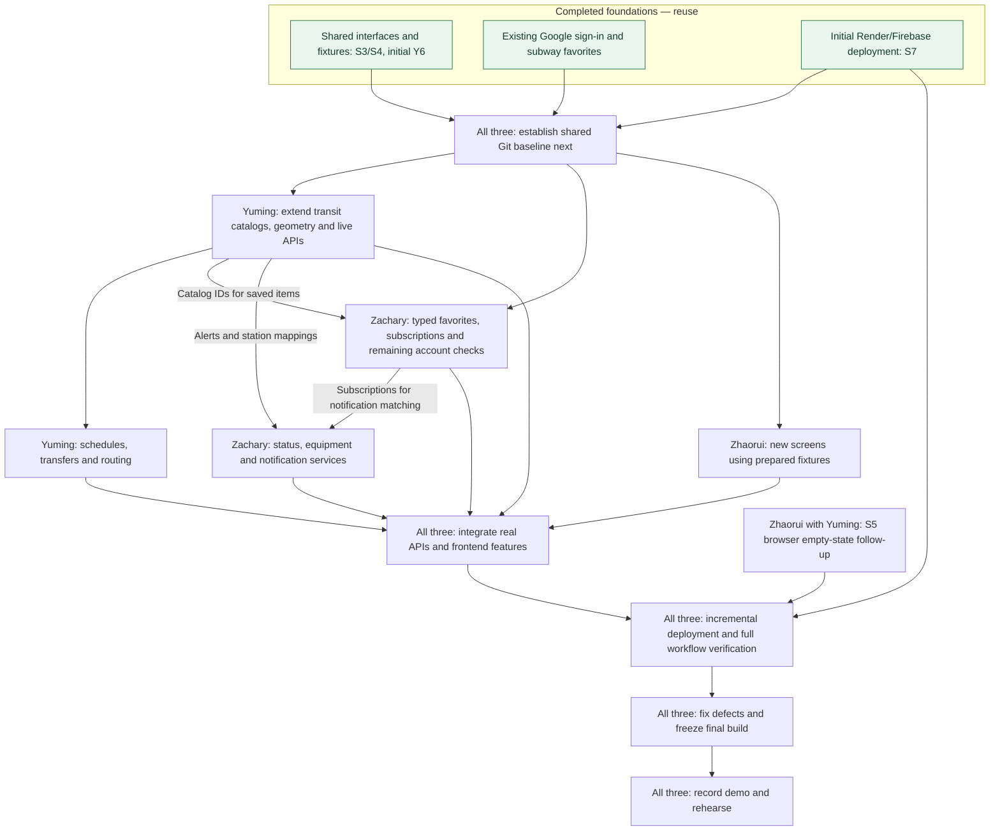

# NYC Transit Hub — Three-Member Final Delivery Workplan

Updated: November 24, 2026  
Final presentation: November 30, 2026  
Delivery: deployed web application

This plan replaces the previous four-member checkpoint plan. It describes remaining delivery work and the final feature target; it does not certify that old tasks are complete. S1–S7 foundations are reconciled below against the current code and recorded evidence. Reuse completed portions; verify only remaining extensions and regressions.

## 1. Team ownership

| Owner | Primary ownership | Responsibilities |
| --- | --- | --- |
| **Yuming** | Transit data, routing, technical integration | Static imports; shared identifiers and API contracts; subway/bus feed integration; schedules; routing; integration reviews and deployed transit verification |
| **Zachary** | Accounts, personalized features, supporting APIs, backend deployment | Firebase; favorites; subscriptions; in-app notifications; service-status and equipment APIs; hosted Flask backend |
| **Zhaorui** | Frontend, visualization, frontend deployment | Existing frontend integration; map; search and transit details; dashboard; journey planner; account and notification UI; languages; responsive layout; hosted frontend |
| **All three** | Quality and final presentation | Test owned features, resolve integration defects, document behavior, prepare evidence, and rehearse |

Yuming coordinates integration; each owner implements and verifies their own work. Zachary owns equipment retrieval and status/equipment endpoints, with Yuming supplying shared mappings and helping interpret transit data. Zhaorui owns shared frontend request/refresh code; coordinate changes with Yuming instead of editing it independently.

## 2. Agreed final scope

| Feature | Final target |
| --- | --- |
| Coverage | NYC subway and buses. State actual agency/route coverage explicitly; do not claim commuter-rail or every MTA service without implementation. |
| Search and transit details | Search/select subway stations and bus stops/routes; show routes, directions, and relevant information. |
| Live updates | Official arrival predictions and available bus positions, source timestamps, automatic/manual refresh, and explicit failure/stale states. |
| Schedules | Date-appropriate scheduled departures, clearly distinguished from live predictions. |
| Interactive map | Actual route geometry and selectable stations/stops, connected to details; supported live overlays. |
| Service alerts/status | Relevant alerts and overview of supported services, with source-supported statuses and unknown/unavailable states. |
| Journey planning | Origin/destination selection; valid directional connections and transfers; understandable journey legs. Define supported modes and timing limitations. |
| Accounts | Required Firebase authentication, sign-in/out, session restoration, and deployed-domain configuration. Existing Google sign-in can create the Firebase user on first successful sign-in. |
| Favorites | Persistent subway stations, bus stops, and routes, separated by user. |
| In-app notifications | Enable/disable subscriptions; match relevant disruptions; unread indicator and read state; avoid duplicates. Refresh while the app is in use. Background browser push/email is outside this delivery scope. |
| Equipment information | Station-associated elevator/escalator information and reported outages where supported; distinguish unknown from confirmed availability. |
| Languages | User-selectable interface language with remembered choice. Initial dictionaries: English and Simplified Chinese; confirm any other languages before adding them. Original MTA text remains identified as such unless translated. |
| Delivery | Public HTTPS deployment, responsive and keyboard-usable interface, current documentation, verified user flows, slides and recorded backup demo. |

Routing, schedules, map geometry, and status coverage must be backed by the implemented data. Do not use placeholders or a simulated feed as evidence of a completed live feature.

## 3. Tracking and definition of done

Task states: **Not started → In progress → Ready for integration → Verified on deployment**.

For import/library tasks, first verify reproducible outputs and tests; verify their dependent application behavior on deployment before closing the feature. Record evidence such as a commit/PR, test result, response example, or deployed workflow result. “Code exists” is not the same as “finished.”

Each task below is a checklist item. The setup record captures the reviewed state. Dates are targets, not evidence of completion.

## 4. Shared setup — first priority

| ID | Small task | Primary owner | Depends on | Completion check |
| --- | --- | --- | --- | --- |
| S1 | Review repository and branches. | Yuming | None | Complete: repository and branch review recorded in [shared setup](shared-setup.md). |
| S2 | Confirm setup ownership and later handoffs. | Yuming | S1 | Complete: Yuming handled S1–S7. Later implementation work will be divided among Yuming, Zachary, and Zhaorui using the breakdown below. |
| S3 | Agree on shared identifiers. | Yuming | S1 | Complete: subway parent/platform, bus stop/route, and transit-mode conventions agreed. |
| S4 | Draft API requests and success/empty/error responses. | Yuming | S3 | Complete: methods, identifiers, bodies, responses, migration and synthetic success/empty/error examples prepared in API contract/examples. Source validation remains implementation work. |
| S5 | Integrate and verify existing frontend with live Flask. | Yuming | S1 | Integrated; station switching, live display, manual/automatic refresh, timestamp behavior, and failure recovery tested. Local automated empty-state checks passed; browser empty-state checks remain unverified. See shared setup for results and alerts 503 evidence. |
| S6 | Configure Bus Time key and verify a real request. | Yuming | None | Complete: real request returned 6 visits, 4 with ETAs; credentials remain backend-only. |
| S7 | Configure Render/Firebase deployment. | Yuming | None | Configured; local favorites and hosted account/favorites checks passed, confirmed by Yuming. Complete based on verified deployment, live data, CORS, Google sign-in, and favorites; see [deployment documentation](deployment.md). |

**Setup progress:** S4 interface definitions and S7 initial deployment are complete.
[API contracts](api-contract.md) and [usable examples](examples/README.md) are ready
for implementation; source validation remains assigned to later tasks. See
[deployment documentation](deployment.md) for S7 evidence.

**S5 follow-up:** Browser verification of empty arrivals and alerts remains open.
Local automated checks passed; see [S5 evidence](shared-setup.md#s5-verification).
This follow-up does not block S4/S7 completion or contract-based development.

**Next:** Establish the shared Git baseline, then create feature branches. All
three share ongoing deployment responsibility.

### Existing interfaces to preserve

The reviewed app uses Flask and station-based APIs, not the old midpoint slide's unified status interface:

- GET /api/health — application health and configured mode, not proof of upstream availability.
- GET /api/stations?search=...
- GET /api/stations/:station_id/arrivals
- GET /api/alerts?route_id=...
- GET/POST /api/favorites and DELETE /api/favorites/:station_id — existing station-only contract.

The existing station favorites contract is preserved. Live subway map geometry is implemented in Y3. Its bus mode, parallel v2 favorites/migration, and other new transit/status/schedule/equipment/journey/subscription/notification interfaces are **defined in S4 and prepared for later implementation**, not implemented features.

Keep [api-contract.md](api-contract.md) authoritative and update it with implementation changes. Existing arrival polling waits 30 seconds after a polling request completes; coordinate refresh changes and respect each source's usage constraints.

## 5. Yuming: transit data, routing, integration

### A. Static-data foundation

| ID | Small task | Depends on | Completion check |
| --- | --- | --- | --- |
| Y1 | Run/review the current static import and inspect generated artifacts. | S1 | Complete: fresh official ZIP import/repeatability and tracked/candidate artifacts reviewed; 39 backend tests passed. See [Y1 audit](mta-data.md#y1-static-import-review--november-24-2026). Five changed station records identified; source validation and publication completed in Y2. Subway geometry completed in Y3 and bus discovery import in Y4; schedule retention completed in Y5; schedule evaluation/routing remain later work. |
| Y2 | Validate subway station IDs, parent/platform mappings, routes, and coordinates. | Y1, S3 | Complete: all 496 stations and 1,488 stop mappings reconciled to raw GTFS, including route membership; validated matching catalog pair refreshed locally. Import validation/regressions added; 65 backend tests passed. See [Y2 validation](mta-data.md#y2-source-validation--november-24-2026). No deployment performed. |
| Y3 | Retain/import route geometry and expose it in the agreed representation. | Y1, S4 | Complete for subway: 261 validated GeoJSON shapes across 29 routes retained; live GET /api/map supports route/bbox filters. 104 backend tests passed; see [Y3 validation](mta-data.md#y3-subway-geometry--november-24-2026). Bus geometry import completed in Y4; bus map API remains Y13 and frontend map remains C4. No deployment performed. |
| Y4 | Import bus routes/stops, route-stop relationships, geometry, and agency references. | S3, S4 | Complete: 392 source routes, 13,621 stops, 776 ordered groups and 9,930 geometry features imported with validated agency/route/stop links. 128 backend tests passed; see [Y4 validation](mta-data.md#y4-bus-discovery-import--november-24-2026). One source-degenerate Q3 line reported/omitted. Public bus APIs remain Y13; realtime remains Y10–Y12. |
| Y5 | Preserve schedule trips, ordered stops, calendars, exceptions, and transfer information needed by downstream features. | Y1, Y4 | Complete: subway + six bus GTFS feeds retained as validated indexed local artifacts with tracked manifest; 250,842 trips, 7,999,282 stop_times, calendars/exceptions and 613 subway transfers. 148 tests passed; see [Y5 audit](mta-data.md#y5-schedule-retention--november-24-2026). Source-only stop/coverage gaps explicit; bus transfer data absent. Evaluation/APIs/routing remain Y14–Y24. |
| Y6 | Supply clearly labeled station, stop, route, geometry, arrival, schedule, and journey response fixtures early; refine as real adapters finish. | S4 | Complete: 39 operations / 188 synthetic cases and five UI replay scenarios refined against imported entities/geometry, with missing-ETA, overnight and coverage-unavailable states. 152 backend tests passed; see [fixture handoff](examples/README.md#y6-fixture-refinement--november-24-2026). Y5 diagnostics preserved; future adapters may require fixture updates with contract changes. |
| Y7 | Document source, import date, validation, regeneration, and required deployment artifacts. | Y2, Y3, Y4, Y5 | Complete: [build runbook](data-build.md) covers provenance, clone/offline replay, refresh and deployment inventory; checksum verifier and local source bundle prepared. Full seven-feed replay matched retained payloads/database hashes; 159 tests passed. Runtime loading/deployment remain Y15/B22. |

Y5 source retention is complete for both modes. Y14–Y18 can use the retained feeds; Y19–Y24 still require graph, transfer, coverage and timing validation. Regenerate the ignored local databases from the tracked manifest before schedule work.

### B. Realtime integration

| ID | Small task | Depends on | Completion check |
| --- | --- | --- | --- |
| Y8 | Reverify existing subway arrivals across representative feed groups and multi-group stations. | S1 | Complete: fresh captures from all eight groups verified at 12 stations, including three-group G08 and 7/FS/H mappings; source event/parent/direction/timestamp checks and explicit 503 behavior passed. See [Y8/Y9 report](subway-verification.json). |
| Y9 | Verify normalized subway alerts and affected route/stop information; explain coverage limitations. | S1, S4 | Complete: fresh alert capture and R/A/7/SI filters verified; internal affected-entity normalizer preserves selectors/parent mappings and prefers plain English. Scope/unknown impact/stale 503 limitations documented in [Y8/Y9 audit](mta-data.md#y8-arrivals-and-y9-alerts-verification--november-25-2026). 176 tests passed; public rich-alert endpoint remains Y13, status/notifications remain B work. |
| Y10 | Integrate bus arrival predictions and supported vehicle positions. | S6, Y4, S4 | Complete: catalog-validated `/api/bus/stops/:stop_id/arrivals` and `/api/bus/vehicles`; live audit on Nov 25 passed with 90 arrivals at 9 stops and 121 vehicles on 8 routes (all boroughs, SBS, MTA Bus Co., express), data ~0.1 s old. See [Y10 report](bus-verification.json). 230 backend tests passed. No deployment performed. |
| Y11 | Integrate bus alerts and map affected route/stop references. | Y4, S6, S4 | Complete: internal catalog-aware bus alert client; live audit on Nov 25 mapped all 121 referenced routes across 106 active alerts, none unmapped (no stop selectors observed). See [Y11 report](bus-alerts-verification.json). Public `/api/transit/alerts` remains Y13. |
| Y12 | Add/reuse timeout, freshness, validated caching, and explicit-error behavior for bus requests. | Y10, Y11 | Complete: configurable timeouts/freshness, redirect refusal, one validated cached body per stop/route with local filtering, per-key cache locks, failure eviction/pruning, explicit 503 with key-free logged reasons; no fictional fallback. See [API contract](api-contract.md#bus-request-behavior-y12). 246 backend tests passed. |
| Y13 | Connect agreed search/detail/arrival/map-data endpoints to the service layer. | S4, Y2, Y3, Y4, Y8, Y10, Y12 | Ready for integration: all prepared discovery/detail/map/arrival/vehicle/affected-alert endpoints registered (station detail, subway/bus routes, bus stops, bus map, `/api/transit/alerts`), with offline contract tests; 246 backend tests passed. Remaining: deployed verification on Render. |

### C. Schedules

| ID | Small task | Depends on | Completion check |
| --- | --- | --- | --- |
| Y14 | Resolve active services for a selected date, including calendar exceptions. | Y5 | Complete: `service_calendar.active_services` resolves calendar weekdays/ranges plus added/removed exceptions per feed; dates outside the published feed period are refused, not shown as empty. Subway Thanksgiving/Christmas resolve to Sunday service; see [Y14 notes](mta-data.md#y14-active-services-by-service-date--november-25-2026). Clock-time/overnight mapping remains Y16. |
| Y15 | Return departures by stop, route, direction, and date. | Y14, S4 | Complete locally: `scheduled_departures` serves subway stations and bus stops across feeds with route/direction filters, skips arrival-only stops and sorts by real time; schedule store verifies and opens the retained feeds read-only. See [Y15–Y18](mta-data.md#y15y18-scheduled-departures--november-25-2026). |
| Y16 | Handle trips past midnight and New York timezone/daylight-saving behavior. | Y15 | Complete: GTFS noon-minus-12h origin converted in UTC; 24:00+ trips keep their service date, cross-midnight windows include earlier service days, both DST changes tested. |
| Y17 | Expose scheduled departures separately from realtime predictions. | Y15, Y16, S4 | Complete locally: `GET /api/schedules` returns `timing_basis:"schedule"` with the schedule import time, never calls realtime feeds; 404 unknown IDs, 503 coverage gaps/out-of-period dates, 200 [] for empty service days. Deployment packaging remains B22. |
| Y18 | Test weekday/weekend, exception-date, empty, overnight, and relevant timezone cases. | Y17 | Complete: synthetic feeds through the real importer plus real-data checks (R20, B63) cover all listed cases; 264 backend tests passed. |

### D. Routing backend

| ID | Small task | Depends on | Completion check |
| --- | --- | --- | --- |
| Y19 | Build directed connections from valid ordered stops, keeping mode/route/direction information. | Y5 | Connections follow real service paths. |
| Y20 | Add valid transfers, including supported cross-mode links; document walking assumptions. | Y19 | Transfers do not rely only on similar names or arbitrary proximity. |
| Y21 | Implement origin/destination search and explicit no-path behavior. | Y20, S4 | Returned paths are valid for the declared graph. |
| Y22 | Group paths into journey legs with boarding/alighting stops, routes, and transfers. | Y21 | Frontend receives understandable instructions. |
| Y23 | Define optimization and timing basis; use schedules if making time-aware claims. | Y21; Y17 for schedule-based timing | Complete: interface declares fewest-transfers optimization and schedule timing basis. Remaining: implement/validate that basis and document transfer/time assumptions; no unsupported live rerouting. |
| Y24 | Test direction, transfers, same endpoints, disconnected paths, and each declared mode. | Y22, Y23 | Tests verify the supported routing scope. |
| Y25 | Integrate and verify planner UI with Zhaorui. | Y22, Y23, C11 | A deployed user can request and inspect a real journey. |

### E. Integration leadership

- Review contract changes and help resolve identifier/field mismatches.
- Coordinate small reviewed merges and shared-file ownership.
- Verify deployed transit workflows with each feature owner.
- Keep source coverage, refresh behavior, limitations, and test evidence current.
- Do not take over teammates' entire implementation workload; escalate blockers early.

Main areas: backend/app/data/, backend/scripts/, static_gtfs.py, mta_client.py, transit_service.py, transit-related routes/tests, and API/architecture documentation. New modules should have clear ownership.

## 6. Zachary: accounts, personalized services, supporting APIs, deployment

### A. Firebase accounts

| ID | Small task | Depends on | Completion check |
| --- | --- | --- | --- |
| B1 | Configure Firebase project, Google Auth, and Firestore. | S7 | Complete in S7: Firebase project, Google Auth and Firestore configured by Yuming. Reuse existing project. |
| B2 | Configure local/deployed authorized domains. | B1, S7 | Complete in S7 for current localhost/deployed frontend domains. Remaining: configure/verify any future hostname changes. |
| B3 | Configure frontend Firebase settings with Zhaorui and backend credentials securely. | B1 | Complete in S7 for current frontend settings/backend credentials. Remaining: new environment/feature configuration as needed; keep secrets backend-only. |
| B4 | Verify sign-in/out, reload/session restoration, canceled sign-in, and errors. | B2, B3, C12 | Complete portion: existing Google sign-in and hosted account checks confirmed in S7; session listener/restoration code present. Remaining: explicitly record canceled/failed popup, sign-out and reload cases, and regressions across future screens; no separate case-by-case browser evidence claimed. |
| B5 | Verify protected API token checks and user derivation. | B3 | Missing/invalid tokens cannot access private records. |
| B6 | Deploy/verify intended Firestore rules and backend authorization. | B1, B5 | Direct client access and backend access match the design. |

### B. Favorites and preferences

| ID | Small task | Depends on | Completion check |
| --- | --- | --- | --- |
| B7 | Define saved-item records for stations, bus stops, and routes; agree on existing-favorite migration. | S3, S4 (complete) | Complete: typed station/stop/route identity, storage compatibility and legacy/v2 migration contract defined in API contract. Remaining migration implementation belongs to B8. |
| B8 | Complete validated add/list/remove operations and duplicate prevention. | B5, B7 | Complete portion: existing station-only add/list/remove with document upsert. Remaining: implement v2 bus/route operations and compatibility projection, validate types, duplicate/concurrent behavior and retired-item removal. |
| B9 | Verify persistence across reload/sign-in sessions. | B8 | Complete portion: existing station favorites checks confirmed locally/hosted in S7; remount persistence covered by simulated-store tests. Remaining: explicit cross-sign-in and all new saved-type persistence cases. |
| B10 | Verify isolation using two accounts. | B8 | Users cannot read/change each other's records. |
| B11 | Persist enable/disable notification subscription preferences. | B5, S4/B7 (definitions complete); independent of favorite saves | Preferences can be changed and restored. |
| B12 | Define/store notification read state. | B5, S4 | Complete portion: read/unread fields, timestamps and API defined in S4. Remaining: persist read state/counts and verify concurrent/user-isolated updates. |

### C. Status and equipment services

| ID | Small task | Depends on | Completion check |
| --- | --- | --- | --- |
| B13 | Define status labels/precedence from actual normalized source fields, with Yuming. | S4 examples (ready); Y9 for subway, Y11 for bus validation | Complete portion: status/impact enums and conservative precedence defined in S4. Remaining: verify actual source effects/authoritative status mapping; unknown stays explicit. |
| B14 | Implement status responses with unknown/unavailable states and source timing information. | B13 | Retrieval failure never implies normal service. |
| B15 | Retrieve equipment information and reported outages; map to stations using shared IDs. | S4, Y2 | Station associations and source timestamps are correct. |
| B16 | Distinguish reported outage, known status, unknown, and unavailable where supported. | B15 | No-outage results do not falsely prove accessibility. |

B13–B14 can start with subway alerts before the bus adapter finishes.

### D. In-app notifications

| ID | Small task | Depends on | Completion check |
| --- | --- | --- | --- |
| B17 | Match normalized alerts to route/station/stop subscriptions using supported affected-entity data. | S4 examples, B11; Y9 for subway, Y11 for bus live matching | Matching is relevant and its limitations are documented. |
| B18 | Identify new/materially changed notices; deduplicate refreshes and concurrent evaluation. | B17 | Unchanged alerts do not repeatedly notify. |
| B19 | Expose notification list/unread/mark-as-read operations; define refresh evaluation while app is open. | B12, B18, S4 | Complete portion: list/unread/read and explicit refresh-evaluation interface defined in S4. Remaining: implement evaluator/API, transactional deduplication and verify UI workflow. |
| B20 | Verify unsubscribe and cross-user behavior. | B19 | Disabled subscriptions stop new notifications; data stays private. |

### E. Backend deployment

| ID | Small task | Depends on | Completion check |
| --- | --- | --- | --- |
| B21 | Deploy the existing Flask foundation early using an appropriate production server. | S7, S1 | Complete in S7: existing Flask backend hosted with Gunicorn; health/connectivity checks recorded. Reuse service. |
| B22 | Configure environment values, credentials, origins/API routing, and required imported data artifacts. | B21; coordinate C20/Y7 | Complete portion in S7: existing subway catalog, live mode, Firebase credentials and frontend/API origins work. Remaining: verify hosted bus-key access and configure new geometry/schedule artifacts as features arrive. |
| B23 | Redeploy incremental features and verify accounts, persistence, transit APIs, and recovery online. | B22, relevant features | Feature owners can test the real hosted system. |
| B24 | Document deployment, configuration, redeployment, and operational limitations. | B23 | Complete portion: initial configuration, redeploy instructions and limitations in deployment.md. Remaining: update for new artifacts/features and verify reproducibility. |

Main areas: Firebase service/configuration, favorites and new personalized routes/services, status/equipment modules, firestore.rules, backend tests and deployment documentation. Coordinate transit_service.py changes with Yuming.

## 7. Zhaorui: frontend and visualization

| ID | Small task | Depends on | Completion check |
| --- | --- | --- | --- |
| C1 | Verify/integrate existing frontend branch improvements. | S1 (integrated); S5 browser follow-up separate | Complete for existing frontend: branch improvements integrated; station/live/refresh/recovery evidence in S5. S5 browser empty-state follow-up remains separate. |
| C2 | Build shared navigation and consistent page/panel structure. | S4 | Every feature is reachable. |
| C3 | Add subway/bus route/station/stop search and selection. | S4 examples (ready); Y13 for live integration | Complete portion: subway station search/selection. Remaining: bus routes/stops, route details and navigation into new views. |
| C4 | Build map, route geometry, selectable stops/stations, and selection synchronization. | S4 examples (ready); Y3/Y4/Y13 for live integration | Map and detail view agree. |
| C5 | Add available live bus-position overlays with timestamps and unavailable states. | C4, S4 examples (ready); Y10 for live integration | Positions are sourced and not fabricated. |
| C6 | Complete arrival display, refresh states, and explicit stale-result handling. | S4 examples (ready); Y8/Y10 for live integration | Old trains do not misleadingly remain at zero minutes. |
| C7 | Add date/direction schedule controls and clearly labeled departures. | S4 examples (ready); Y17 for live integration | Users distinguish schedules from predictions. |
| C8 | Display relevant alerts for supported routes/stops; fix first-route-only/empty-state ambiguity. | S4 examples (ready); Y9/Y11 for precise/live coverage | Complete portion: hook fetches all subway alerts and matches every station route (not only first), retaining unscoped notices; empty wording/local tests present. Remaining: S5 browser empty states, precise affected-entity coverage, bus alerts and new views; stop-only relevance remains limited. |
| C9 | Build service-status overview with notices and update/source information. | S4 examples (ready); B14 for integration | Unknown/unavailable states are visible. |
| C10 | Build equipment panel with outage, unknown, and unavailable states. | S4 examples (ready); B15/B16 for integration | UI does not overclaim accessibility. |
| C11 | Build origin/destination selection, journey legs, transfers, and no-path states. | S4 examples (ready); Y22/Y23 for live integration | Planner is understandable and honest about timing. |
| C12 | Build/connect sign-in/out and account states. | B3 (complete); B4 for remaining checks | Complete portion: Google sign-in/out controls, auth-state listener, signed-out/loading/error favorites states and hosted sign-in foundation. Remaining: canceled/failed sign-in and sign-out/reload verification with B4; account states across new screens. |
| C13 | Add save/remove actions and saved-items view for supported types. | B7/S4 (complete); B8 for v2 integration | Complete portion: existing station save/remove/list/reopen UI and S7 favorites checks; local simulated-store tests cover recovery/remount. Remaining: typed bus-stop/route saved-items views and v2 integration. |
| C14 | Add subscription controls, notification panel, unread indicator, and read actions. | S4 examples (ready); B11/B19 for integration | Personalized notification flow works. |
| C15 | Extract UI text into English/Chinese dictionaries; add language selector. | C2; develop alongside other UI | Navigation, controls, statuses, and errors switch consistently. |
| C16 | Remember language choice and define original-language MTA alert treatment. | C15 | Reload preserves the selection; untranslated text is clearly handled. |
| C17 | Coordinate automatic/manual refresh, bounded waiting, request cleanup, and stale-response guards with Yuming. | C1, S4; relevant APIs for integration | Complete portion: existing subway hook has 30-second completion-based polling, manual refresh lock, 45-second timeout, cleanup/abort and stale-response guards. Remaining: reuse/test across bus and new screens; retain S5 browser empty-state follow-up. |
| C18 | Verify loading/empty/error/recovery states on all feature screens. | Integrated screens | No blank/misleading failure experience. |
| C19 | Verify responsive layout, keyboard access, focus visibility, and non-color-only information. | Integrated UI | Core workflows work on desktop/mobile-sized views and without a mouse. |
| C20 | Deploy frontend early; connect hosted backend/Firebase; redeploy as features arrive. | S7, B21/B22 for integrated checks | Complete portion in S7: frontend deployed and connected to hosted Flask/Firebase; live/account/favorites verified. Remaining: incremental feature redeploys and integrated checks. |

Frontend fixtures must be clearly labeled. Existing B3 configuration and C12 controls are complete foundations; C12/B4 retain the additional account cases and verification across future screens. Contract-based UI development can start from S4 examples after the shared Git baseline is established.

Main areas: frontend/src/pages/, components/, services/, hooks/, styles.css, language dictionaries, frontend tests and hosting configuration.

## 8. Dependency chart

Completed foundations cover the existing scope; account edge-case checks and
bus-stop/route favorites remain in X. S5's browser empty-state follow-up remains
separate from completed S7. After the shared Git baseline, Zhaorui can build from
fixtures while backend work proceeds. Catalog and alert edges apply to the
corresponding extensions: status/equipment need not wait for notifications, and
subway work need not wait for bus source validation. Real feature integration
requires the relevant APIs; final verification covers all supported workflows.

### What can proceed in parallel

| Work | Parallel work / prerequisite |
| --- | --- |
| Bus access | S6 key/access check complete; detailed adapter field checks and hosted configuration remain. |
| Static imports | Reuse completed Firebase/deployment foundation; frontend can use S4 examples. |
| Map/planner UI | Backend adapters/routing, using completed S4 contracts and fixtures. |
| Favorites | Transit feeds, schedules, maps, and routing, after shared IDs. |
| Languages | Ongoing frontend development using one dictionary structure. |
| Deployment | Initial setup complete in S7; incremental deployment follows feature work after shared Git baseline. |
| Notification panel | Matching backend using completed S4 response/read-state contracts. |
| Real notification matching | Requires subscriptions and normalized affected-entity data. |
| Routing | Requires valid static connectivity/transfers; schedule-based claims additionally need schedule handling. |

## 9. Remaining delivery schedule

These are ambitious targets for three people. Do not mark a target as achieved without evidence. If a deadline slips, identify the blocker and affected dependent features that day; explicitly agree on any scope adjustment rather than hiding unfinished work.

| Date | Yuming | Zachary | Zhaorui | Shared gate |
| --- | --- | --- | --- | --- |
| Nov 24 | Complete: S1–S4 definitions, S6 access, S7 setup by Yuming; prepared examples and reconciled handoff | Reuse completed Firebase/backend setup and station favorites; take remaining B work after baseline | Reuse integrated frontend/deployment/account/station-favorites foundations; build new screens from S4 examples after baseline | S4/S6/S7 complete; S5 browser empty-state follow-up open; shared Git baseline next, before implementation branches |
| Nov 25 | Extend imports/live responses and schedule/routing foundations | Extend typed favorites/supporting APIs; remaining account checks | Build/connect map and new transit views using prepared examples | Reuse verified public foundation; integrate new features after baseline |
| Nov 26 | Complete supported schedules/routing and remaining transit integration | Complete subscriptions, notifications, status/equipment APIs | Connect planner, notifications, equipment, language switching | Every targeted feature has an integrated implementation, or an explicit unresolved blocker |
| Nov 27 | Verify data/schedules/routing; fix defects | Verify accounts/isolation/notifications/deployment; fix defects | Verify mobile/languages/refresh/error states; fix defects | Full deployed user-flow checks completed |
| Nov 28 | Fix defects and prepare technical evidence | Fix defects and document backend/deployment | Fix defects, final UI checks and demo captures | Feature freeze; slides and backup recording ready |
| Nov 29 | Final data/live checks and technical explanation | Final deployment/account checks | Final UI check and demonstration run | Rehearse together; identify final deployed revision |
| Nov 30 | Pre-presentation transit checks | Pre-presentation service checks | Pre-presentation UI checks | Final presentation |

## 10. Shared verification checklist

Each owner supplies tests appropriate to their changes. Run backend tests and frontend build, then test full workflows on the deployed public URL.

- [ ] Subway: search → select station → live arrivals → schedules → relevant alerts → equipment information.
- [ ] Bus: select route/stop on map → predictions/available positions → schedule → relevant alerts.
- [ ] Routing: valid directional journey, transfers, supported modes, reverse direction, same endpoints, and no-path cases.
- [ ] Accounts: successful/canceled/failed sign-in, session reload, and sign-out.
- [ ] Favorites: save each supported item type, reload/sign in again, reopen, remove, and check duplicates.
- [ ] Isolation: two users cannot access each other's favorites, subscriptions, notifications, or read state.
- [ ] Notifications: subscribe → explicitly labeled test disruption → one relevant notification → mark read → refresh without duplicate → unsubscribe.
- [ ] Language: change language → visit every feature → trigger empty/error states → reload and verify persistence.
- [ ] Refresh: rapid selection changes and manual/automatic refresh do not cause stale responses or duplicate polling.
- [ ] Failure/recovery: upstream/backend unavailable states remain explicit; retained data keeps original timestamps; recovery works.
- [ ] Schedule correctness: service exceptions, overnight times, and timezone behavior verified.
- [ ] Accessibility: equipment data distinguishes unknown from known status; interface supports keyboard and readable non-color-only information.
- [ ] Deployment: HTTPS, API connectivity, Firebase domains, required data artifacts, secrets configuration, and fresh browser/mobile-sized use verified.
- [ ] Documentation: README, API contract, architecture, source coverage, limitations, setup and deployment match implemented behavior.
- [ ] Evidence: current test/build/live-check results are recorded; historical smoke checks are not described as current uptime.

Use clearly labeled fixtures for rare conditions such as alert changes or equipment outages. Do not present simulated conditions as live MTA events.

## 11. Final presentation and completion

All three explain their own contributions and participate in rehearsal.

1. Identify and record the final deployed revision.
2. Rerun tests/build and core deployed workflows.
3. Show the problem, architecture, completed features, engineering decisions, evidence, limitations, and individual contributions.
4. Record a backup demonstration of the deployed application.
5. Confirm the final presentation time limit; the earlier five-minute plan was for the midpoint and is not automatically the final limit.
6. Rehearse speaker transitions and failure/backup handling.
7. Check deployment, Firebase, and transit feeds before presenting on November 30.

The final application is complete when a user can search and inspect supported transit options, use the map and planner, understand freshness and failures, sign in, persist favorites/subscriptions, read relevant in-app notifications, switch interface language, and return to saved preferences on the deployed site.
